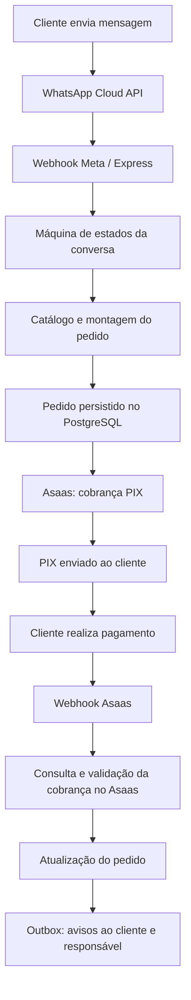

<div align="center">

# 🤖 WhatsApp PIX Bot

### Atendimento comercial, pedidos e cobranças PIX em uma única conversa.

**Node.js 20 · Express · WhatsApp Cloud API · Asaas · PostgreSQL · Prisma · Docker · Vitest**

[](https://nodejs.org/)
[](https://www.postgresql.org/)
[](https://www.docker.com/)


</div>

## 💡 Sobre o projeto

O **WhatsApp PIX Bot** é um backend de automação comercial que permite ao cliente montar um pedido por mensagens, informar dados para entrega e receber uma cobrança PIX diretamente no WhatsApp. A integração com o **Asaas** gerencia a cobrança; um webhook notifica o sistema sobre mudanças no pagamento, que são verificadas novamente na API antes de atualizar o pedido.

O objetivo é reduzir tarefas manuais no atendimento e explorar uma arquitetura confiável para integrações com serviços externos.

> **Estado atual:** o repositório relata **42 testes automatizados com mocks aprovados**. Isso **não equivale a uma validação ponta a ponta**: a execução real com PostgreSQL/Prisma, Docker, WhatsApp Cloud API e Asaas ainda precisa ser confirmada antes de qualquer uso em produção.

## ✨ Funcionalidades implementadas no código

- 💬 **Atendimento conversacional** com fluxo de estados e menu textual.
- 🛒 **Montagem de pedidos** com catálogo configurável e cálculo de valores no servidor.
- 📍 **Coleta de endereço e CPF** para o processamento do pedido/cobrança.
- 💸 **Cobrança PIX via Asaas**, com envio de informações de pagamento pelo WhatsApp.
- 🔔 **Webhooks** da Meta e do Asaas para receber mensagens e eventos de cobrança.
- 🔎 **Verificação do pagamento na API do Asaas** antes de marcar um pedido como pago.
- 📦 **Persistência de pedidos e eventos** com PostgreSQL e Prisma.
- 📤 **Outbox de notificações** para comunicação com o responsável e o cliente.
- 🧪 **Testes automatizados** com Vitest e repositório em memória para cenários isolados.

## 🔄 Como funciona



## 🧱 Stack

| Camada | Tecnologias | Responsabilidade |
| --- | --- | --- |
| API | Node.js 20, Express | Rotas, webhooks e serviços |
| Mensageria | WhatsApp Cloud API (Meta) | Receber e enviar mensagens |
| Pagamentos | Asaas | Criar e consultar cobranças PIX |
| Banco de dados | PostgreSQL, Prisma | Persistência e migrations |
| Validação e proteção | Zod, Helmet, rate limiting, HMAC | Validar entradas e proteger endpoints |
| Observabilidade | Pino | Logs estruturados |
| Testes | Vitest | Testes automatizados isolados |
| Ambiente | Docker, Docker Compose | Empacotamento e orquestração local |

## 🗂️ Organização

```text
src/
├── config/          # Ambiente, catálogo, logs e banco
├── controllers/     # Entrada dos webhooks
├── middlewares/     # Assinaturas, limites e erros
├── repositories/    # Persistência Prisma e memória
├── routes/          # Health, readiness e webhooks
├── services/        # Conversas, pedidos, pagamentos e outbox
├── utils/           # CPF, valores, segurança e mutex
└── validators/      # Validação de payloads
prisma/              # Schema e migrations
tests/               # Testes automatizados
Dockerfile
docker-compose.yml
.env.example
```

## 🚀 Executar localmente

**Pré-requisitos:** Node.js 20, npm e Docker com Compose para o PostgreSQL.

```bash
git clone https://github.com/marciovin/whatsapp-pix-bot.git
cd whatsapp-pix-bot
npm install
cp .env.example .env
```

Preencha as variáveis do `.env` com as credenciais de teste e configurações indicadas no `.env.example`. **Nunca publique esse arquivo nem credenciais reais.**

```bash
# Iniciar apenas o banco
docker compose up -d db

# Preparar o Prisma e o schema
npx prisma generate
npm run migrate:deploy

# Iniciar o backend
npm run dev
```

**Alternativa com containers:**

```bash
docker compose up -d --build
docker compose logs -f app
```

**Testes:**

```bash
npm test
```

**Endpoints de saúde:** `GET /health` e `GET /ready` (este retorna 503 se o banco estiver indisponível).

## 🔌 Configuração das integrações

### WhatsApp Cloud API

1. Configure um aplicativo na plataforma de desenvolvedores da Meta com WhatsApp Cloud API.
2. Preencha as variáveis `WHATSAPP_APP_SECRET`, `WHATSAPP_PHONE_NUMBER_ID`, `WHATSAPP_ACCESS_TOKEN` e `WHATSAPP_VERIFY_TOKEN` no `.env`.
3. Disponibilize um endpoint HTTPS público para `POST /webhooks/whatsapp` e configure a verificação e assinatura do webhook.
4. Configure o número de teste ou comercial e, quando necessário, um template aprovado para avisar o responsável fora da janela de atendimento.

### Asaas

1. Use **primeiro o sandbox** e configure `ASAAS_ENV=sandbox` e `ASAAS_API_KEY`.
2. Configure os dados de cobrança exigidos pela sua conta e o token `ASAAS_WEBHOOK_TOKEN`.
3. Registre `POST /webhooks/asaas` como destino de eventos de cobrança.
4. Simule um pagamento no sandbox e confira a transição do pedido e as notificações.

Para receber webhooks localmente, exponha a porta 3000 com um túnel HTTPS, como Cloudflare Tunnel ou ngrok. Confira sempre a documentação oficial e os requisitos atuais das APIs antes de ativar integrações reais.

## 🔐 Decisões de segurança e confiabilidade

- Verificação da assinatura HMAC das mensagens da Meta.
- Validação do token do webhook Asaas.
- Validação de entradas e configurações com Zod.
- Deduplicação de mensagens e tratamento idempotente de eventos.
- Conferência de identificador, referência, valor e estado da cobrança diretamente no Asaas.
- Transições de pagamento condicionais no banco para reduzir inconsistências.
- Logs com mascaramento de dados sensíveis.
- Outbox para reprocessamento de notificações.

**Limitações conhecidas:** a entrega de notificações pode ocorrer mais de uma vez em falhas específicas; o mutex de conversas é local ao processo; ainda são recomendados reconciliação periódica de cobranças, limpeza de eventos antigos, política de retenção de dados e validação operacional completa. Dados pessoais exigem tratamento compatível com a LGPD.

## 🧪 Antes de colocar em produção

- [ ] Executar migrations e verificar a persistência real no PostgreSQL.
- [ ] Validar subida e reinício com Docker Compose.
- [ ] Testar envio e recebimento reais com a Meta.
- [ ] Testar geração, confirmação e falha de cobrança no sandbox Asaas.
- [ ] Confirmar idempotência e comportamento sob reentrega de webhooks.
- [ ] Configurar templates, HTTPS, backups, monitoramento e retenção de dados.
- [ ] Realizar teste ponta a ponta controlado antes de habilitar cobranças reais.

## 🛣️ Possíveis evoluções

- Painel administrativo de pedidos e catálogo.
- Reconciliação automática de pagamentos pendentes.
- Métricas de atendimento e monitoramento de falhas.
- Mensagens interativas e melhorias de experiência do cliente.
- Testes de integração e pipeline de CI.

## 👨‍💻 Autor

Desenvolvido por **Márcio Vinícius** como projeto de estudo e aplicação prática de integrações backend, automação comercial e pagamentos.

**GitHub:** [@marciovin](https://github.com/marciovin)

---

> Projeto em evolução. Integrações externas e cobranças devem ser validadas em ambiente de testes antes do uso comercial.
